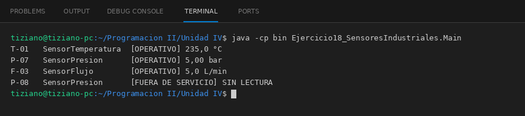

# SensorIndustrial

Programación II - Unidad 4 - Ejercicio 18

## Consigna
Leer sensores industriales de distinta tecnología desde un panel central.

## Lógica
- Clase abstracta `SensorIndustrial` (idSensor, estadoOperativo) con `String leerMetrica()`.
- `SensorTemperatura` convierte voltios a °C, `SensorPresion` convierte un lazo de 4 a 20 mA a bar y `SensorFlujo` convierte pulsos por minuto a L/min.
- `PanelControl` recorre los sensores; los que están fuera de servicio muestran SIN LECTURA.
- `Main`: cuatro sensores, uno de ellos fuera de servicio.

## Ejecución

